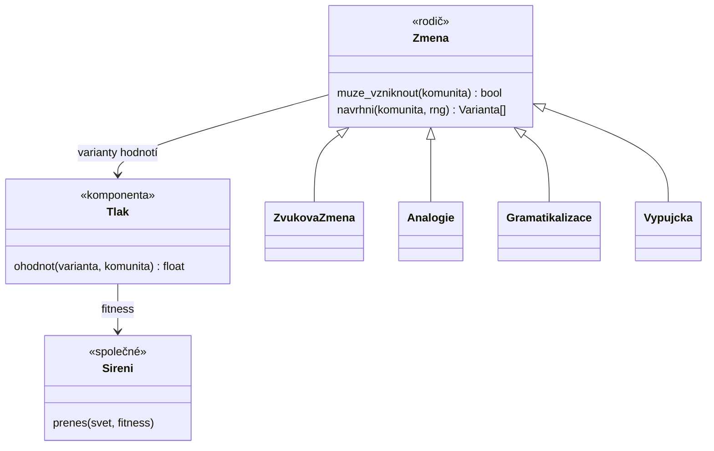
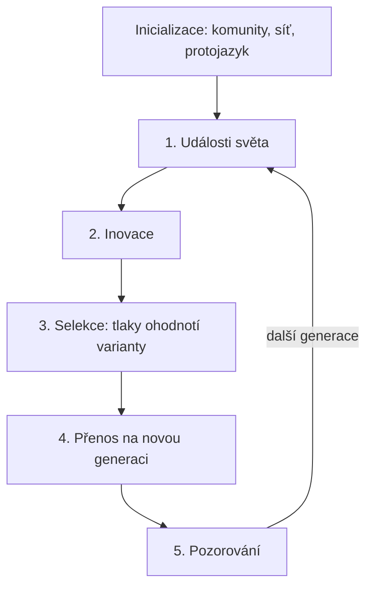

# Iterace 1 — jádro enginu

Cíl této iterace: hlavní smyčka a stavební kameny, nic víc. Co je tu
napsáno abstraktně („proměnná“, „varianta“), zpřesní iterace 2.

## Stavební kameny

**Svět** je množina komunit, síť mezi nimi a časová osa autorských událostí.

**Komunita** je skupina lidí na místě (vesnice, město, region):

- poloha, velikost populace,
- vazby na jiné komunity (síla kontaktu) a prestiž v očích sousedů,
- instituce (škola, písmo, správa) — na počátku obvykle žádné,
- **repertoár**: co a jak se v komunitě říká.

**Repertoár** je mapa `Proměnná → {Varianta: frekvence}`. Frekvence jedné
proměnné dávají dohromady 1.

- *Proměnná* je místo, kde může existovat variace: výslovnost /t/ mezi
  samohláskami, slovo pro „vodu“, koncovka 2. pádu, pozice slovesa ve větě.
- *Varianta* je jedna možná hodnota proměnné. Nese svůj původ: která změna
  ji vytvořila, kdy a ve které komunitě.

Jazyk komunity **je** její repertoár. Žádný jiný „stav jazyka“ neexistuje.

**Jazyk a dialekt** se nezadávají. Vzniknou pozorováním: komunity s
podobnými repertoáry tvoří shluk. Autor může shluk pojmenovat; strom jazyků
je výstup simulace, ne vstup.

## Tři vrstvy mechanismů



- **`Změna`** (rodič) ví jen dvě věci: *kdy* může vzniknout a *jakou
  variantu* vyrobí. Podtřídy se liší jen v tom, co je jejich varianta.
- **`Tlak`** je samostatná komponenta. Ohodnotí variantu číslem
  (výhoda/nevýhoda). Jeden tlak (např. frekvence) působí na mnoho druhů
  změn, proto se nedědí, ale skládá.
- **`Šíření`** je jedno pro všechny změny: přenos repertoáru na další
  generaci a mezi komunitami. Z něj vznikají S-křivky, vlny a izoglosy.

## Hlavní smyčka

Jeden krok (`tick`) = jedna generace, výchozí hodnota 25 let.



1. **Události světa.** Autorské události (migrace, válka, založení města,
   škola, tisk) změní komunity a síť. Nemění repertoár přímo.
2. **Inovace.** Pro každou komunitu a každý typ `Změna`: pokud
   `muze_vzniknout`, s malou pravděpodobností `navrhni` vytvoří novou
   variantu s nízkou počáteční frekvencí (jednotky procent). Většina inovací
   zanikne — to je správně.
3. **Selekce.** Každý `Tlak` připojený ke změně ohodnotí každou živou
   variantu v dané komunitě. Součet dá *fitness* varianty v této komunitě.
4. **Přenos.** Nová generace se učí ze směsi: vlastní komunita plus sousedé
   vážení silou vazby a prestiží. Výsledné frekvence posune fitness a
   přidá se náhodný drift úměrný `1/√populace` (malé komunity se mění
   rychleji a nahodileji). Pod prahem varianta zaniká; nad prahem se stává
   normou a stará varianta mizí.
5. **Pozorování.** Zapíše se historie (vznik, ustálení, zánik variant),
   spočítají se vzdálenosti komunit a shluky (dialekty, jazyky).

### Přenos — první nástřel vzorce

Pro komunitu *c* a proměnnou *v*:

```
mix(x)   = (1 − m_c) · p_c(x) + m_c · Σ_j  w_cj · prestiž_j · p_j(x) / Z
sel(x)   = mix(x) · exp(s · fitness_c(x))
p'_c(x)  = normalizuj(sel(x) + drift_c(x)),   drift ~ N(0, σ / √populace_c)
```

- `m_c` — otevřenost komunity vůči sousedům (mobilita, obchod),
- `w_cj` — síla vazby, `Z` — normalizace vah,
- `s` — síla selekce (globální kalibrační konstanta).

S-křivka není naprogramovaná: vyplyne z opakovaného přenosu s výhodou
(replikátorová dynamika). Vlny a izoglosy vyplynou z toho, že sousedé
přebírají varianty postupně podle síly vazeb.

## Determinismus

Každý náhodný tah má seed odvozený z `(seed světa, tick, komunita,
mechanismus)`. Pořadí zpracování komunit je pevné. Krok 4 počítá novou
generaci ze *staré* generace všech komunit (dvoufázově), takže pořadí
komunit neovlivní výsledek.

## Otevřené otázky pro iteraci 2

- Jak zvuková změna zasáhne slova: je to jedna proměnná pro celé
  prostředí (např. „/t/ mezi samohláskami“), proměnná pro každé slovo,
  nebo obojí? Odtud vyplývá pravidelnost vs. lexikální difuze.
- Jak je uložené slovo: podkladová forma + seznam ustálených změn, nebo
  přímo aktuální tvar?
- Co je proměnná v gramatice: koncovka, konstrukce, slovosled?
- Řád velikosti: kolik komunit × proměnných musí smyčka zvládnout.
