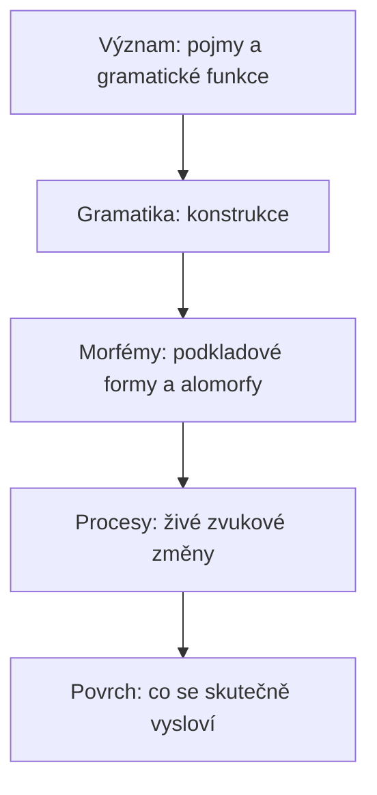

# Iterace 2 — reprezentace jazyka

Cíl: říct, z čeho se skládá repertoár, tedy co přesně jsou „proměnné“ a
„varianty“ z iterace 1, a jak se z nich dá spočítat, co lidé skutečně
vyslovují.

## Od významu ke zvuku

Repertoár jednoho kódu (jazykové variety, viz iterace 4) má pět vrstev.
Každá horní vrstva se realizuje pomocí té pod ní.



1. **Význam.** Pojmy (Concepticon ID: `WATER`, `HAND`) a gramatické funkce
   (`PAST`, `PLURAL`, `GENITIVE`, `NEGATION`, `DEFINITE`…). Význam se
   nevyvíjí; mění se jen to, *čím* se vyjadřuje.
2. **Gramatika.** Konstrukce: šablony, které skládají morfémy a slova do
   tvarů a vět. Patří sem paradigmata i syntax.
3. **Morfémy.** Kořeny, afixy a funkční slova. Každý morfém má uloženou
   podkladovou formu a případné alomorfy.
4. **Procesy.** Zvukové změny, které právě probíhají. Ještě nejsou součástí
   uložených forem, ale už ovlivňují výslovnost.
5. **Povrch.** Výsledek: morfémy poskládané podle konstrukcí a prohnané
   živými procesy. Povrch se neukládá, počítá se (s cache).

## Hlásky a prozodie

- **Segment** je vektor rysů PanPhon (převezmeme `FeatureMapper`). Segmenty
  se internují do tabulky, takže forma je pole celých čísel.
- **Inventář se neukládá.** Je to množina segmentů, které se vyskytují v
  povrchových formách. Díky tomu nemůže „ujet“ od lexikonu.
- **Slabiky** se počítají ze sonority při každém přepočtu povrchu.
- **Přízvuk, délka a tón** jsou prozodická vrstva nad slabikami. Pravidlo
  přízvuku (např. „na první slabice“, „na předposlední“) je samo proměnná,
  takže se může měnit a šířit jako cokoli jiného.

## Morfém

```
Morfém
  id, linie            — linie přežije všechny změny tvaru
  význam               — pojem nebo gramatická funkce (může jich být víc: polysémie)
  třída                — kořen / afix / klitika / funkční slovo
  alomorfy[]           — (forma, podmínka); podmínka = buňky paradigmatu
  frekvence            — tokenová frekvence užití
  původ                — zděděný / vypůjčený (odkud, kdy) / utvořený (z čeho)
```

Většina morfémů má jeden alomorf. Další alomorfy vznikají zvukovou změnou
přes morfémovou hranici (viz morfologizace níže) a mizí analogií.

## Konstrukce

```
Konstrukce
  funkce               — co vyjadřuje (PLURAL, PAST, TRANSITIVE_CLAUSE…)
  šablona              — uspořádané sloty: [kmen][PL] nebo [S][V][O]
  exponenty            — které morfémy sloty plní (afix -i, předložka de…)
  vázanost             — volné slovo / klitika / afix (stupeň gramatikalizace)
  frekvence            — jak často se užívá
```

- **Paradigma** je množina konstrukcí nad jednou třídou slov. Buňka
  paradigmatu (např. `N.GEN.PL`) je konkrétní tvar, který z nich vznikne.
- **Syntax** je tentýž mechanismus o úroveň výš: větná konstrukce má sloty
  pro fráze. Slovosled je pořadí slotů.

Plný syntaktický parser nepotřebujeme. Stačí vědět, které konstrukce
existují, jak často se užívají a čím se plní.

## Čtyři typy proměnných

| Typ | Klíč | Varianty | Příklad |
|---|---|---|---|
| **Procesní** | přirozená třída + prostředí | nezměněno / výstup změny | /t/ mezi samohláskami: `t` 60 %, `d` 40 % |
| **Lexikální** | pojem | morfémy, které ho vyjadřují | `WATER`: *aqua* 70 %, *akwa-* (výpůjčka) 30 % |
| **Formová** | morfém + buňka paradigmatu | alomorfy | `mohu` 55 % / `můžu` 45 % |
| **Konstrukční** | gramatická funkce | konstrukce | `FUTURE`: *cantabo* 20 %, *cantare habeo* 80 % |

Kategorie, která v jazyce chybí (např. člen), je konstrukční proměnná s
jedinou variantou „nevyjadřuje se“. Vznik členu je pak nová varianta.

Proměnná s jedinou variantou na 100 % je **ustálená** a nic nestojí.
Výpočet běží jen nad **živými** proměnnými, kde soutěží alespoň dvě varianty.

## Jak zvuková změna zasáhne slova

Tady se potkávají mladogramatici (změna je pravidelná) a lexikální difuze
(změna jde slovo po slově). Model obsahuje oba principy.

### Fáze 1: fonetická

Změna vznikne jako **procesní proměnná**. Její frekvence říká, jak často
mluvčí v daném prostředí vysloví novou variantu. Pravděpodobnost pro
konkrétní slovo se od ní odchyluje:

```
p_slovo = σ( logit(p_proces) + β_frekv · frekvence_slova + b_slovo )
```

- `σ` je logistická funkce,
- `β_frekv` je kladné pro redukční změny (častá slova vedou, Bybee) a
  záporné pro změny „posilující“,
- `b_slovo` je malý seedovaný sklon konkrétního slova; z něj vzniknou výjimky.

### Fáze 2: fonologizace (restrukturalizace)

Když nová generace slyší novou variantu tak často, že ji považuje za
základní (`p_slovo > θ`, výchozí θ = 0,85), **přepíše si podkladovou formu**
morfému. Proces pro tento morfém skončí.

- Morfémy, které práh překročí, se přepíšou → změna vypadá pravidelně.
- Morfémy, které práh nepřekročí (vzácná slova, slova se sklonem proti), si
  starou formu ponechají a proces u nich časem vyhasne → **reliktní výjimky**.
- Když proces vyhasne v celém lexikonu, procesní proměnná zanikne.

### Fáze 3: morfologizace

Když proces zasáhl přes morfémovou hranici (např. kmen před afixem),
restrukturalizace nepřepíše kmen všude. Vytvoří **nový alomorf** jen pro
buňky paradigmatu, kde podmínka platila. Pokud pozdější změna podmínku
odstraní, alternace zůstane jako čistě gramatická.

Příklad (německý typ umlautu):

```
1. kmen gast + plurál -i        → povrch gasti
2. proces a → e před i          → gesti (fonetická fáze, šíří se)
3. fonologizace přes hranici    → alomorf gest- v buňce PL
4. apokopa koncového -i         → gest   (plurál už nese jen samohláska)
5. analogie (iterace 3)         → může alternaci rozšířit, nebo vyrovnat
```

Nic z toho není zvlášť naprogramované. Stačí procesy, restrukturalizace a
alomorfy.

### Pořadí změn

Živé procesy se na povrch aplikují v pořadí svého vzniku. Pozdější proces
vidí výstup dřívějšího. Vztahy „změna A připraví půdu pro B“ nebo „změna A
vezme B půdu“ (feeding a bleeding) tak vznikají samy z chronologie.

## Povrch je rozdělení, ne jeden tvar

Při procesu na 40 % má slovo dva povrchové tvary. Pro různé účely se
používá různé shrnutí:

- **přenos** pracuje jen s frekvencemi proměnných, povrch nepotřebuje,
- **tlaky** (homofonie, fonotaktika) počítají s dominantním tvarem a se
  střední hodnotou přes varianty,
- **pozorování a export** ukazují dominantní tvar a seznam živých variant.

## Frekvence užití

- Výchozí tokenové frekvence mají Zipfovo rozdělení. Základní slovní zásoba
  (Swadesh) a funkční morfémy začínají vysoko.
- Frekvence morfému = součet přes konstrukce, ve kterých se užívá. Když
  konstrukce zeslábne, zeslábnou i její morfémy.
- Frekvence řídí redukci, odolnost vůči analogii i rychlost lexikální
  náhrady (častá slova se nahrazují pomaleji; Pagel a kol. 2007).

## Co se mění oproti iteraci 1

- „Proměnná“ a „varianta“ mají čtyři konkrétní typy.
- Změna se nepromítá do slov přímo. Procesní proměnná ovlivní povrch a
  teprve fonologizace přepíše uložené formy.
- Gramatika jsou konstrukce s morfémy, které podléhají zvukovým změnám jako
  všechno ostatní.
