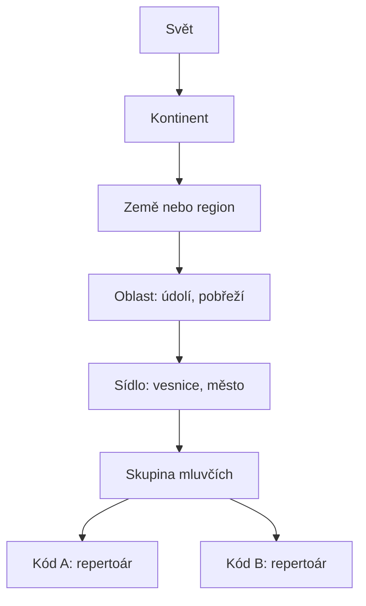
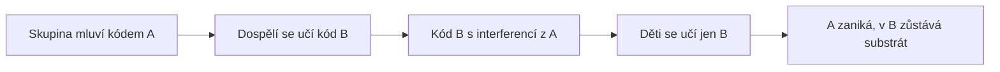

# Iterace 4 — společnost a prostor

Cíl: kdo mluví, s kým, kde a jak se jazyk předává. Iterace zpřesňuje
„komunitu“ z iterace 1 a krok „Přenos“.

## Kdo mluví

- **Území** (svět, kontinent, region, oblast) nese terén: hory a moře
  oslabují vazby, řeky a cesty je posilují. Terén se zadává na mapě. Autor
  nemusí strom území rozepsat celý, viz Víceúrovňový svět.
- **Sídlo** má polohu a velikost. Město je uzel s mnoha vazbami.
- **Skupina mluvčích** je základní jednotka simulace. Tím **se mění
  iterace 1**: „komunita“ je skupina. V jednom sídle může být několik skupin
  (šlechta a poddaní, řemeslníci, kněží, přistěhovalci). Skupina má:
  - velikost populace,
  - prestiž (jak ji vidí ostatní),
  - otevřenost (jak moc se učí od cizích),
  - gramotnost a školní docházku (na počátku nula),
  - jeden nebo více **kódů**.
- **Kód** je jedna jazyková varieta, kterou skupina užívá. Má vlastní
  repertoár (iterace 2), podíl užívání a informaci, zda se ho skupina učí
  jako první jazyk (od dětství), nebo jako druhý (v dospělosti).

Dvojjazyčná skupina tak drží dva repertoáry. Jazyk, dialekt ani rodina
nejsou nikde uložené (viz Pozorování).

## Síť

Vazba mezi dvěma skupinami má:

| Vlastnost | Význam |
|---|---|
| síla | jak často spolu mluví |
| typ | silná (rodina, sousedé) / slabá (obchod, úřad) |
| směr prestiže | kdo se od koho spíš učí |
| sdílený kód | kterým kódem spolu mluví |

**Výchozí síla** se odvodí z gravitačního modelu (Trudgill): úměrná
součinu velikostí sídel, nepřímo úměrná vzdálenosti a upravená terénem.
Autor může vazby přidat, zesílit nebo zrušit, například obchodní trasou nebo
hranicí státu.

- **Silné vazby** uvnitř uzavřených skupin drží normu (Milroy).
- **Slabé vazby** mezi skupinami přenášejí inovace (Granovetter).
- Města jsou uzly mnoha slabých vazeb, proto inovace přeskakují z města do
  města a teprve potom se rozlévají na venkov.

## Víceúrovňový svět a přiblížení (drill-down)

Svět je strom území: svět → kontinent → země nebo region → oblast → sídlo →
skupina. Autor rozepíše jen to, co ho zajímá.

- **Aktivní jednotky.** Simulace běží nad listy právě rozepsaného stromu.
  Nerozepsané území je jedna **souhrnná skupina**: součet populace, vážený
  průměr prestiže a otevřenosti, jeden repertoár.
- **Vazby souhrnných skupin** se odvodí z gravitačního modelu nad jejich
  těžišti a délkou společné hranice.
- **Vnitřní rozmanitost.** Souhrnná skupina nemůže mít dialekty. Nese proto
  odhad vnitřní rozmanitosti (podle rozlohy, populace a terénu). UI ji ukáže
  jako „nerozlišeno“ a pozorování ji nepovažuje za jednolitý dialekt.

### Postup autora

1. Načrtne svět: kontinenty, velké migrace, protojazyky jako populace.
2. Spustí hrubou simulaci, která je rychlá, a uvidí obrysy jazykových rodin.
3. Přiblíží se k oblasti, která ho zajímá, a rozepíše ji na regiony a sídla.
4. Simulace se přepočítá. Postup opakuje tak hluboko, jak potřebuje.

### Jak přiblížení zachová historii

| Režim | Co se stane | Kdy |
|---|---|---|
| **Přepočet od začátku** (výchozí) | celý svět se odsimuluje znovu s jemnější mapou; díky determinismu se vzdálené oblasti změní jen tolik, kolik jsou se zjemněnou oblastí propojené | když autor chce konzistentní historii |
| **Zjemnění od roku X** | podřízená území převezmou repertoár souhrnné skupiny v roce X a od té doby se vyvíjejí samostatně; dřívější historie zůstane hrubá | rychlý náčrt, nebo když území opravdu vzniká až v roce X (založení města, kolonizace) |

### Režimy v UI

Všechny režimy používají stejný model. Liší se výchozím rozlišením a
rozpočtem aktivních jednotek.

| Režim | Aktivní jednotky | Zbytek světa |
|---|---|---|
| Údolí, oblast | 10–50 skupin (vesnice, společenské vrstvy) | několik souhrnných „vnějších“ skupin jako zdroj kontaktu |
| Region | 50–200 | sousední regiony souhrnně |
| Země | 100–500 | sousední země souhrnně |
| Kontinent | 200–1 000 | ostatní kontinenty souhrnně |
| Svět | do ~1 000 | méně zajímavá území souhrnně |

Strop aktivních jednotek plyne z výkonového rozpočtu (iterace 5). UI ho
ukáže jako „rozpočet rozlišení“.

## Délka generace

Každá skupina má vlastní délku generace `G`, výchozí je 25 let. Fantasy
národ může mít 500 let a sdílet s lidmi jednu síť.

- Krok simulace má pevnou délku `Δt`. Výchozí je 25 let, nejvýš však
  nejkratší `G` ve světě.
- Za jeden krok se ve skupině obnoví podíl populace `r = Δt / G`. Jen tato
  část se jazyk učí znovu; zbytek jsou dospělí, kteří se mění málo.
- Každá změna deklaruje, čím se řídí její tempo:
  - **generacemi**, pokud vzniká hlavně při osvojování jazyka (zvukové,
    morfologické a syntaktické změny): tempo × `r`,
  - **kalendářním časem**, pokud ji dělají dospělí (nová slova, výpůjčky,
    posuny významu): tempo × `Δt`.
- Dlouhověký národ tak mění výslovnost a gramatiku pomalu, ale nová slova a
  výpůjčky přijímá podobně rychle jako lidé.

## Přenos — zpřesnění

Krok 4 z iterace 1 se dělí podle toho, kdo se učí.

### Děti (první jazyk)

Děti se učí od dospělých ve skupině a od sousedů vážených sítí. Oproti
iteraci 1 přibývají dvě věci:

- **Inkrementace** (Labov): děti posunou variantu, která roste, ještě o
  kus dál. Do vzorce přibude člen `κ · (p_t − p_{t−1})`. Tím mají změny směr
  a trvají generace.
- **Zostření**: nekonzistentní vstup děti srovnávají k většinové variantě
  (Hudson Kam & Newport). To dělá tlak `Konformita`.

Děti se učí jen kódy, které v jejich okolí mají dostatečný podíl užívání
(výchozí práh 20 %). Kód pod prahem se dětem nepředá.

### Dospělí

Dospělí mění repertoár jen málo (přizpůsobení okolí, nová slova). Jejich
změna je jen zlomek dětské.

### Dospělí, kteří se učí nový kód (druhý jazyk)

Když se dospělí učí cizí kód, učí se ho nedokonale:

- nepravidelné a vzácné varianty se ztrácejí (`Učitelnost`),
- procesní a konstrukční varianty z jejich prvního jazyka se přenášejí do
  nového (**interference**).

Čím větší podíl takových mluvčích kód má, tím silněji ho tyto tlaky
přetvářejí. To je Trudgillovo zjednodušení při kontaktu.

## Přechod na jiný jazyk a substrát

Přechod se nemodeluje zvlášť, vyplývá z pravidel výše:

1. Skupina mluví kódem A a začne se učit prestižní kód B.
2. Dospělí mluví B s interferencí z A.
3. Podíl A klesne pod práh, děti se ho neučí.
4. Děti se učí B od rodičů, tedy i s interferencí. Ta se v B ustálí.

Výsledek je například irská angličtina. Pokud se naopak menšinová elita
naučí jazyk většiny (Normané ve Francii, Frankové v Galii), proces běží
opačným směrem a v jazyce většiny zůstane **superstrát** (hlavně slova).
Který směr nastane, rozhoduje poměr velikostí, prestiž a doba kontaktu.

## Instituce a standard

Instituce jsou vlastnosti skupin a sídel, které se mění událostmi:

| Instituce | Účinek |
|---|---|
| **Písmo** | vznikne psaný kód: zmrazený obraz řeči elity v roce kodifikace. Mění se mnohem pomaleji než mluvená řeč. |
| **Gramotnost** | podíl lidí, na které působí psaný kód. |
| **Škola** | děti se učí i z psaného kódu; zapne tlak `Norma` úměrný docházce. |
| **Tisk** | rychlé šíření psaného kódu mezi sídly, zesílí sjednocování psaného kódu. |
| **Správa a církev** | slabé vazby na velkou vzdálenost; prestiž úředního nebo liturgického kódu. |

**Diglosie vzniká sama.** Mluvená řeč se dál mění, psaný kód stojí. Rozdíl
mezi nimi roste, dokud ho škola a tisk nezačnou zmenšovat. Do té doby
psaný kód působí jen jako zdroj učených výpůjček.

Standardizace je tedy pozdní: bez písma a školy nemá `Norma` na koho
působit.

## Události

Událost **mění strukturu** světa (skupiny, sídla, vazby, instituce). Na
jazyk působí jen nepřímo, přes přenos. Dlouhodobé následky proto vzniknou
samy, bez zvláštního modelu.

| Událost | Co udělá se strukturou |
|---|---|
| Migrace | přesune část skupiny jinam; vytvoří nebo rozšíří skupinu v cílovém sídle |
| Založení města | nové sídlo, přitahuje migraci a vazby |
| Dobytí | nová elitní skupina s vysokou prestiží; úřední vazby na velkou vzdálenost |
| Válka | oslabí vazby přes frontu, sníží populaci |
| Epidemie | sníží populaci (víc driftu v malých skupinách) |
| Kolaps státu | zruší dálkové vazby a školy, sníží gramotnost |
| Obchodní trasa | slabé vazby mezi sídly na trase |
| Hranice státu | posílí vazby uvnitř, oslabí přes hranici |
| Zavedení písma, školy, tisku | instituce výše |
| Náboženská změna | nový prestižní (liturgický) kód |

## Pozorování: vznik jazyků

Krok 5 z iterace 1 počítá:

1. **Vzdálenost kódů.** Pro každou dvojici kódů vážený rozdíl přes
   proměnné: podíl sdílené základní slovní zásoby, fonetická vzdálenost
   tvarů, shoda gramatických konstrukcí.
2. **Shlukování.** Hierarchické shlukování podle vzdálenosti. Dvě hladiny:
   pod prahem *dialekt*, nad prahem *samostatný jazyk* (přibližná míra
   vzájemné srozumitelnosti).
3. **Linie shluků.** Shluk v dalším snímku se spáruje s předchozím podle
   překryvu skupin. Když se shluk rozpadne na dva, zapíše se **rozštěpení**.
   Z těchto záznamů vznikne strom jazyků.
4. **Jména.** Autor pojmenuje shluk; jméno se drží linie. Nový shluk dostane
   jméno odvozené z endonyma skupiny nebo z mapy.

Pohraniční hybridy se ukážou jako kódy, které leží mezi dvěma shluky a
nepatří jasně do žádného z nich. To je správný výsledek.

## Co se mění oproti iteraci 1 až 3

- „Komunita“ se mění na **skupinu mluvčích**, která může mít víc kódů.
- Přenos rozlišuje děti, dospělé a dospělé, kteří se učí druhý jazyk.
- Svět je víceúrovňový strom území; simulace běží nad rozepsanými listy a
  zbytek reprezentují souhrnné skupiny.
- Délka generace je vlastnost skupiny; krok simulace obnoví jen podíl
  `Δt / G` populace.
- Přechod na jiný jazyk, substrát, diglosie i standardizace nejsou zvláštní
  mechanismy; vyplývají ze struktury a přenosu.
